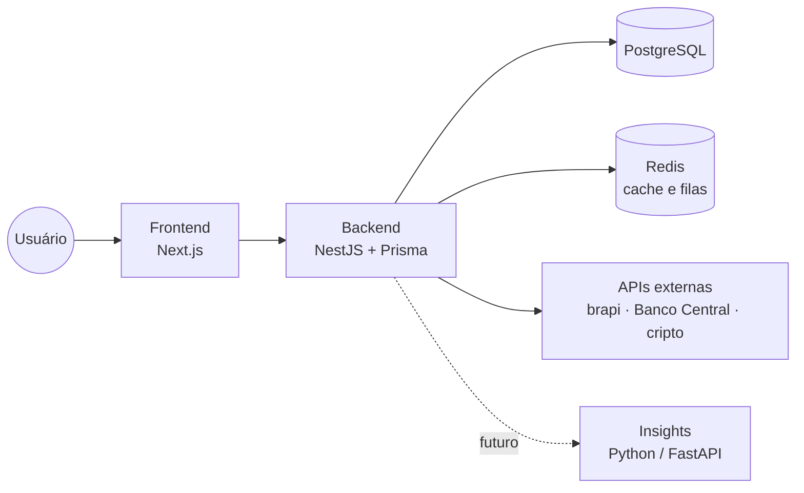

# FinTrack

> Gestão financeira pessoal pensada para o mercado brasileiro: contas, transações, orçamento por categoria e investimentos (CDB, Tesouro, cripto) em um só lugar.


**Status:** em desenvolvimento.

<!-- Adicione prints do dashboard em docs/screenshots/ e referencie aqui -->
<!--  -->

## Sobre o projeto

O FinTrack nasceu para resolver um problema comum: lançar as mesmas transações várias vezes e ter o dinheiro espalhado em bancos, corretoras e planilhas. A ideia é centralizar tudo, com foco em investimentos brasileiros (renda fixa atrelada a CDI, Selic e IPCA) e em automações que reduzem o trabalho manual.

## Funcionalidades

- **Contas e cartões:** múltiplas contas (corrente, poupança, cartão, carteira, corretora)
- **Transações:** receitas, despesas e transferências, com categorias, tags, recorrência e parcelamento
- **Importação** de extratos CSV/OFX com detecção de duplicatas
- **Orçamento por categoria** com alerta ao atingir o limite
- **Investimentos:** renda fixa (CDB, LCI/LCA, Tesouro), ações/FIIs e cripto, com cotações via APIs externas
- **Glossário integrado:** tooltips explicando termos como CDI, Selic e IPCA
- **Integração bancária (Open Finance)** somente leitura, via agregador
- **Autenticação completa:** cadastro, verificação de e-mail, recuperação de senha
- **Interface responsiva:** desktop, tablet e mobile

## Arquitetura



- O **frontend nunca chama APIs externas**: tudo passa pelo backend, que faz cache e respeita os limites de cada provedor.
- Um **cron job** atualiza cotações apenas dos ativos que algum usuário possui.
- A integração bancária fica atrás de uma interface (`BankProvider`), permitindo trocar de agregador ou usar importação de arquivo sem alterar o restante do sistema.

## Decisões técnicas

- **Dinheiro em `Decimal(14,2)`**, nunca `float`. O valor da transação é sempre positivo e o sinal vem do tipo (receita, despesa, transferência).
- **Saldo não é armazenado, é calculado** a partir do saldo inicial e das movimentações, o que evita inconsistência.
- **Operações atômicas:** transferências e demais escritas em mais de uma tabela usam transações do banco (`prisma.$transaction`).
- **Importação idempotente:** identificador externo único por conta impede lançamentos duplicados.
- **Soft delete** em contas e categorias com histórico (`archivedAt`).
- **Segurança:** senhas e tokens guardados apenas como hash, segredos em variáveis de ambiente, integração bancária somente leitura e isolamento de dados por usuário em todas as queries.

## Estrutura do repositório

```
FinTrack/
├── frontend/              # Next.js (App Router)
├── backend/               # NestJS + Prisma
├── shared/                # código compartilhado (se aplicável)
├── docker-compose.yaml
├── .env.example
└── README.md
```

Mais detalhes em [`backend/README.md`](backend/README.md) e [`frontend/README.md`](frontend/README.md).

## Como rodar

### Pré-requisitos

- [Docker](https://www.docker.com/) e Docker Compose
- Node.js 22+ (apenas para desenvolvimento local fora do Docker)

### Com Docker (stack completa)

```bash
git clone https://github.com/lucasatdriano/FinTrack.git
cd FinTrack

cp .env.example .env   # troque as senhas e segredos
docker compose up -d --build
```

| Serviço    | URL                   |
| ---------- | --------------------- |
| Frontend   | http://localhost:3000 |
| API        | http://localhost:3001 |
| PostgreSQL | localhost:5432        |
| Redis      | localhost:6379        |

### Desenvolvimento local (hot reload)

Suba só a infraestrutura no Docker e rode as aplicações na sua máquina:

```bash
docker compose up -d postgres redis

# terminal 1
cd backend && npm install && npx prisma migrate dev && npm run start:dev

# terminal 2
cd frontend && npm install && npm run dev
```

## Variáveis de ambiente

Veja o [`.env.example`](.env.example). As principais:

| Variável                                              | Descrição                      |
| ----------------------------------------------------- | ------------------------------ |
| `POSTGRES_USER` / `POSTGRES_PASSWORD` / `POSTGRES_DB` | Credenciais do banco           |
| `JWT_SECRET` / `JWT_REFRESH_SECRET`                   | Segredos de autenticação       |
| `FRONTEND_URL`                                        | Origem permitida no CORS       |
| `NEXT_PUBLIC_API_URL`                                 | URL da API usada pelo frontend |

> Nunca versione o arquivo `.env`.

## Roadmap

- [x] Modelagem do banco de dados
- [x] Protótipo de telas (Figma)
- [x] Configuração Docker
- [ ] Autenticação (cadastro, login, verificação de e-mail, recuperação de senha)
- [ ] Contas, categorias e transações
- [ ] Dashboard e relatórios
- [ ] Orçamento com alertas
- [ ] Investimentos e cotações (brapi, Banco Central)
- [ ] Importação de extratos (CSV/OFX)
- [ ] Integração bancária via Open Finance
- [ ] Serviço de insights em Python (categorização automática e previsão de gastos)

## Autor

Feito por **Lucas** — [GitHub](https://github.com/lucasatdriano)
